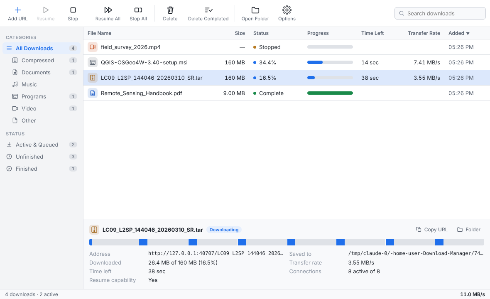
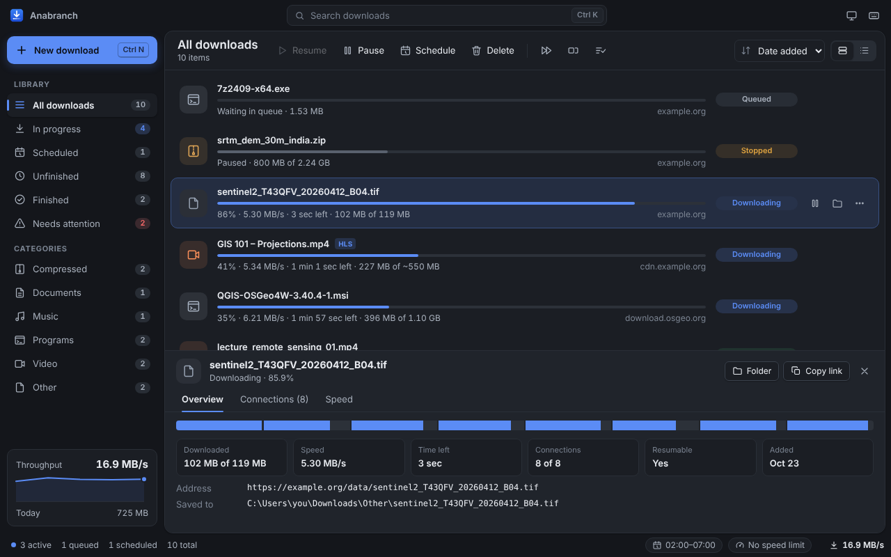
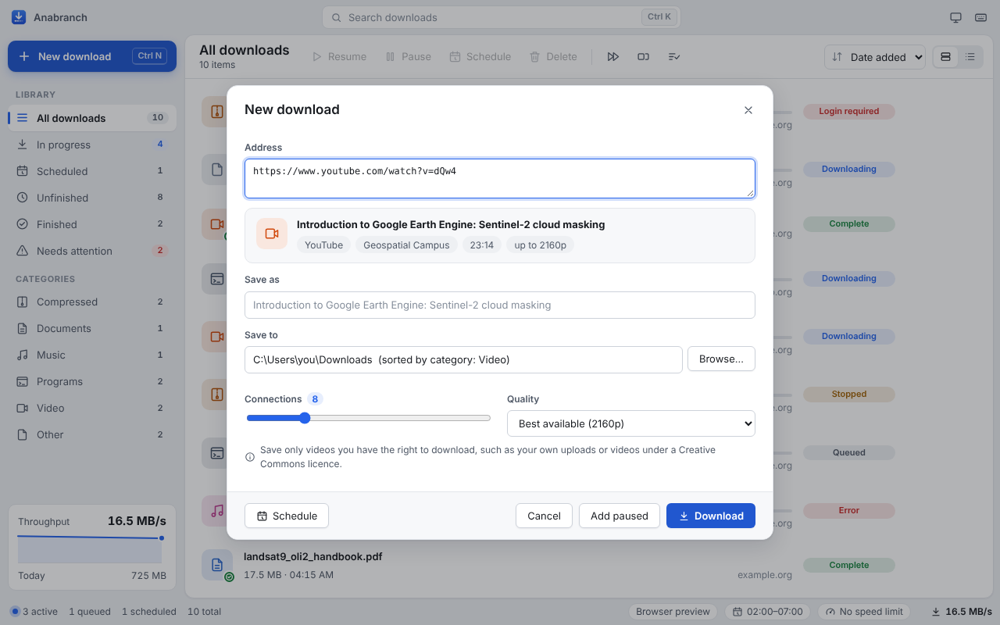

# Anabranch

**Anabranch** is a Windows desktop download manager in the style of Internet Download Manager (IDM). It is built with Electron and React. It has a browser extension for Chrome, Edge and Firefox, and a Model Context Protocol (MCP) server through which Claude, or any other MCP client, can queue and control downloads.

*About the name:* in hydrology, an anabranch is a channel that leaves a river and rejoins it downstream. Anabranch works the same way: each file is split into parallel connections, and they are rejoined into one file.

**Website and live demo:** <https://anabranch.draran.online/>. The demo runs the real interface in the browser with simulated downloads.



<details>
<summary>Dark theme</summary>



</details>

## Interface

| Area | What it offers |
| --- | --- |
| Window | Custom title bar with the native Windows buttons, light, dark or system theme, six accent colours |
| Download list | Two-line rows with progress, speed, time left and source; hover actions (pause or resume, open, folder, more); a compact table view; sorting; search from the title bar |
| Add dialog | Checks a link while you type: real file name, size and resume support, or for streams the qualities and duration; detects servers that need a sign-in; batches show each link's name and size |
| Details pane | Overview with a segment map, a table of connections (or stream tracks) and a speed graph with hover readout |
| Sidebar | Library and category views with counts, a *Needs attention* view, and a live throughput graph with today's total |
| Shortcuts | Command palette (Ctrl+K), Ctrl+V anywhere to add copied links, drag links or a `.txt` list onto the window, Space to pause or resume, `?` for the full list |
| Feedback | Toasts for completed and failed downloads with Open, Show in folder and Retry; overall progress on the taskbar button; a tray icon with quick actions; optional close-to-tray |
| Status bar | Active, queued and scheduled counts; speed-limit presets; scheduler window; total speed |

## Features

| Feature | Behaviour |
| --- | --- |
| Multi-connection downloads | Each file is split into up to 32 byte ranges (8 by default), and the ranges download in parallel over HTTP `Range` requests or FTP `REST`. |
| Dynamic segmentation | A connection that finishes early takes over half of the largest remaining range, so that all connections stay busy until the end. |
| FTP and FTPS | `ftp://` and `ftps://` (implicit TLS) URLs support multiple connections and resume. Anonymous login is used unless credentials are supplied. When a server limits connections, the downloader continues with the connections it was granted. |
| Video streams (HLS and DASH) | `.m3u8` and `.mpd` URLs are resolved to their segments, which download in parallel. AES-128-encrypted HLS is decrypted. The quality can be set to best, worst, or a maximum height. When FFmpeg is present, the segments are merged into one MP4 file. |
| YouTube | Watch pages, Shorts, `youtu.be` links and playlists download through [yt-dlp](https://github.com/yt-dlp/yt-dlp), which the app installs in one click. The Add dialog shows the title, channel, duration and the qualities on offer (up to 4K), or *Audio only* as M4A or MP3. A playlist becomes one download per video. Pause and resume work as for other downloads. |
| Browser integration | The extension hands downloads of chosen file types to the app, together with the browser's cookies and referrer, so that downloads behind a sign-in still work. It also adds right-click menus (*Download with Anabranch* and *Download all links*), lists the video streams a page loads, and puts a **Download** button on YouTube's player. |
| Scheduler | Scheduled downloads start at a set time on chosen weekdays, with an optional stop time. When the queue finishes, the app can do nothing, close, put the computer to sleep or shut it down, after a 60-second countdown that can be cancelled. |
| Login prompts | When a server answers HTTP 401 (Basic or Digest) or FTP 530, the download pauses and the app asks for credentials. A login can be remembered for the whole site. Logins and cookies are encrypted with Windows DPAPI (Data Protection API) and are never written to the download list. |
| Pause and resume | Downloads continue from the saved offsets, including after a restart. A stream resumes from the last segment it completed. |
| Queue and speed limit | A set number of downloads run at once, and a global speed limit in KB/s applies to all connections. |
| Categories | Files are sorted into Compressed, Documents, Music, Programs, Video and Other, optionally into a sub-folder for each category. |
| Clipboard capture | Copying a direct file link opens the Add dialog with that link. |
| MCP server | 16 tools for checking links (YouTube included), downloads, logins, the scheduler and settings. |

## Install

| Way | How |
| --- | --- |
| Installer (recommended) | Download `Anabranch-Setup-<version>.exe` from the [latest release](https://github.com/AranCastro/Download_Manager/releases/latest). It updates itself afterwards. |
| Portable | `Anabranch-Portable-<version>.exe` from the same page runs without installation. It reports new versions but does not replace itself. |
| Scoop | `scoop install https://github.com/AranCastro/Download_Manager/releases/latest/download/anabranch.json` |
| winget | `winget install AranCastro.Anabranch` (once the package is accepted into winget-pkgs) |

The executables are not yet code-signed, so Windows SmartScreen shows a warning on first launch; select **More info → Run anyway**.

**Updates.** The installed app checks GitHub Releases 20 seconds after start and every 6 hours, downloads a new version in the background, and offers **Restart now**. The copy of yt-dlp that the app installed is updated once a day. Both can be switched off under **Options → General → Updates**.

**Builds.** GitHub Actions builds the app and runs the tests on Windows on every push (artifacts **anabranch-windows**, **browser-extension** and **package-manifests**). To publish a release, raise the version in `package.json`, then run **Build Windows exe** from the Actions tab (**Run workflow**) with the matching tag, for example `v1.3.0`. Pushing such a tag works too. [docs/DISTRIBUTION.md](docs/DISTRIBUTION.md) covers the extension stores, winget, Scoop and code signing.

## Browser extension

The installed app contains the extension in `resources\browser-extension\`. **Options → Browser** shows the exact folder and has buttons that open it.

1. **Chrome, Edge, Brave or Opera:** open `chrome://extensions` (or `edge://extensions`), turn on *Developer mode*, choose *Load unpacked*, and select the `chromium` folder.
2. **Firefox:** open `about:debugging#/runtime/this-firefox`, choose *Load Temporary Add-on*, and select `manifest.json` in the `firefox` folder. Release versions of Firefox keep only signed add-ons after a restart; a permanent installation needs the zip to be signed through addons.mozilla.org.
3. Click the Anabranch button in the browser toolbar, then **Connect**. Approve the request in the app window.

The release also contains **store** builds of the extension (`anabranch-extension-*-store-*.zip`) for the Chrome Web Store, Edge Add-ons and addons.mozilla.org. They are identical except that the YouTube button is left out, because the stores do not accept YouTube downloaders; YouTube links still work in the app. The extension's data practices are described in [docs/PRIVACY.md](docs/PRIVACY.md).

Pairing gives each browser its own token; the app stores only a hash of it. **Options → Browser** lists the connected browsers, and each one can be disconnected there. The toolbar panel controls which file types are captured, the minimum file size, the sites to skip, and whether each download is confirmed in the app first. If the app is closed when a download starts, the extension returns the download to the browser.

## YouTube

1. The first YouTube link opens a card in the Add dialog with **Install yt-dlp**. The app downloads the official build from the yt-dlp GitHub releases into `%APPDATA%\Anabranch\tools\`. **Options → General** shows the installed version, updates it, or points to a copy of your own.
2. For HD and 4K, YouTube serves video and audio separately, and FFmpeg joins them. On Windows, **Options → General → Install FFmpeg** fetches a static build into the same folder. Without FFmpeg the app takes the best single-file format (usually 720p or lower), and *Audio only* saves M4A instead of MP3.
3. Paste a link, press **Ctrl+V** anywhere in the window, or use the browser extension: hover over the player and click **Download**, or open the toolbar panel and choose **Download this video**.

The extension sends the browser's YouTube cookies with the link, so signed-in, members-only and age-restricted videos you can watch in the browser also download. YouTube sometimes asks a downloader to confirm that it is not a bot, mostly on shared or datacenter networks. When the app reports this, send the video from the browser extension. Live streams and DRM-protected videos (for example, purchased films) are refused.



Download only videos you own or have permission to save, and follow YouTube's Terms of Service and the copyright law of your country.

## Video streams and FFmpeg

HLS and DASH downloads work without FFmpeg, as follows:

| Stream | Without FFmpeg | With FFmpeg |
| --- | --- | --- |
| HLS, MPEG-TS segments | One `.ts` file (plays in VLC and in most players) | One `.mp4` file |
| HLS with fMP4 segments, or single-track DASH | One `.mp4` file | One `.mp4` file |
| Separate audio and video (most DASH, some HLS) | `name.mp4` (or `.ts`) plus `name.audio.m4a` | One `.mp4` file with both tracks |

FFmpeg can be installed with `winget install Gyan.FFmpeg`. Alternatively, choose `ffmpeg.exe` under **Options → General**. Merging copies the streams; nothing is re-encoded.

Live streams, and streams protected by DRM (Widevine, PlayReady, FairPlay, HLS SAMPLE-AES), are refused with an explanatory message.

## Connecting Claude via MCP

1. Start Anabranch.
2. Open **Options → MCP / AI** and copy the configuration shown there. It contains the correct paths for your installation.
3. Paste the configuration into `%APPDATA%\Claude\claude_desktop_config.json`, then restart Claude Desktop.

```json
{
  "mcpServers": {
    "anabranch": {
      "command": "C:\\Users\\<you>\\AppData\\Local\\Programs\\Anabranch\\Anabranch.exe",
      "args": ["C:\\Users\\<you>\\AppData\\Local\\Programs\\Anabranch\\resources\\mcp\\anabranch-mcp.cjs"],
      "env": { "ELECTRON_RUN_AS_NODE": "1" }
    }
  }
}
```

`ELECTRON_RUN_AS_NODE` makes the app's own runtime execute the MCP server, so Node.js is not required.

| Tool | Purpose |
| --- | --- |
| `probe_url` | Check a link without downloading it: name, size, resume support, stream qualities and duration; for a YouTube link, the title, channel and qualities, or a playlist's videos. |
| `add_download` | Queue a file, FTP link, `.m3u8`/`.mpd` stream or YouTube video (kind `site`; quality `best`, a height such as `1080`, `audio` or `mp3`). Optional inputs: file name, folder, connections, quality, login, extra headers, start now or schedule. |
| `list_downloads` / `get_download` | Report status, progress, speed and segments. |
| `pause_download` / `resume_download` / `pause_all` / `resume_all` | Stop or continue downloads. Resuming a failed download retries it. |
| `remove_download` | Remove a download from the list, and optionally delete the file. |
| `set_credentials` | Supply a login for a download in the `auth-required` state, and retry it. |
| `schedule_download` / `get_scheduler` / `update_scheduler` / `run_scheduler_now` | Manage the scheduled queue and its times, days and after-done action. |
| `get_settings` / `update_settings` | Folder, concurrency, connections, speed limit, and the FFmpeg and yt-dlp paths. |

Example prompt: *"Download the DEM tiles listed at these three FTP links tonight at 1:30 with 4 connections each, then put the computer to sleep."*

### Security of the local API

```
Claude Desktop ──stdio──▶ anabranch-mcp.cjs ──HTTP + token──▶ Anabranch (127.0.0.1:6801)
Browser extension ─────────────────────────────────HTTP + token──▶
```

The REST API listens on `127.0.0.1` only. A request with a web-page `Origin` header is rejected. Every route except `/api/ping` and `/api/pair` requires a bearer token: either the app token in `%APPDATA%\Anabranch\api.json`, which the MCP server reads, or a token issued to a browser extension after the user approved it.

Endpoints:

- `GET|POST /api/downloads`
- `POST /api/probe`
- `GET|DELETE /api/downloads/:id`
- `POST /api/downloads/:id/pause|resume|schedule|credentials`
- `POST /api/prompt` (opens the Add dialog)
- `POST /api/pause-all|resume-all`
- `GET|PATCH /api/settings`
- `GET|PATCH /api/scheduler`
- `POST /api/scheduler/run`
- `GET /api/ping`
- `POST /api/pair`

## Development

Requirements: Node.js 20 or later. FFmpeg is optional; the tests that need it are skipped when it is missing.

```bash
npm install
npm run dev        # Vite dev server + Electron with hot reload
npm test           # 39 tests: engine, HTTP auth, FTP, HLS/DASH, YouTube (with a stand-in yt-dlp), probing, scheduler, API, MCP
npm run build      # renderer, MCP bundle, browser extension (dist-extension/)
npm run dist:win   # Windows installer and portable exe in release/
```

`npx vite` serves the interface in an ordinary browser, where it uses a simulated backend. This is useful for work on the interface alone.

### Project layout

```
electron/
  main.js                    window, IPC, pairing approval, power actions, clipboard, notifications
  preload.js                 the only bridge between the UI and the main process
  api-server.js              local REST API (MCP server and browser extension)
  updater.js                 app updates from GitHub Releases (electron-updater)
  engine/
    DownloadManager.js       queue, concurrency, scheduler hooks, secrets, persistence
    BaseDownload.js          shared state, speed, pause/resume lifecycle
    Download.js              files: probing, segments, dynamic splitting (HTTP and FTP transports)
    http.js                  fetch with Basic/Digest login handling
    ftp.js                   FTP/FTPS range reads (basic-ftp)
    streams/hls.js           HLS playlist parsing, variant choice, AES-128 IVs
    streams/dash.js          DASH manifest resolution (templates, timelines, segment lists)
    streams/StreamDownload.js  parallel segment download, decryption, assembly, FFmpeg merge
    sites/ytdlp.js           yt-dlp arguments, output parsing, error messages
    sites/SiteDownload.js    YouTube and other video pages, run through yt-dlp
    tools.js                 finding and installing yt-dlp and FFmpeg
    Scheduler.js             start/stop times and weekdays
    CredentialStore.js       encrypted logins and cookies
browser-extension/           extension source (one codebase for MV3 Chromium and MV2 Firefox); youtube.js adds the player button
mcp/server.mjs               MCP server (bundled to dist-mcp/ by esbuild)
src/                         React interface
test/                        node:test suites
```

Settings, the download list, encrypted secrets and browser pairings are stored in `%APPDATA%\Anabranch\`. Partial files use the extension `.dmpart`; partial streams are kept in a `.dmparts` folder beside the target.

## Known limitations

- Live streams and DRM-protected streams or videos are not supported.
- YouTube support depends on yt-dlp. When YouTube changes its site, update yt-dlp under **Options → General**. The app does not work around YouTube's bot check; the browser extension's cookies are the supported route.
- For a DASH manifest with several periods, only the first period is downloaded.
- Supported logins are HTTP Basic, HTTP Digest and FTP. NTLM and Kerberos are not supported; form-based sign-ins work through the browser extension, which passes the session cookies.
- Until the store listings are approved, the extension is loaded unpacked (Chromium) or as a temporary add-on (Firefox); see [docs/DISTRIBUTION.md](docs/DISTRIBUTION.md).
- The executables are not yet code-signed (an application to SignPath Foundation is described in the same guide).

## Licence

MIT
